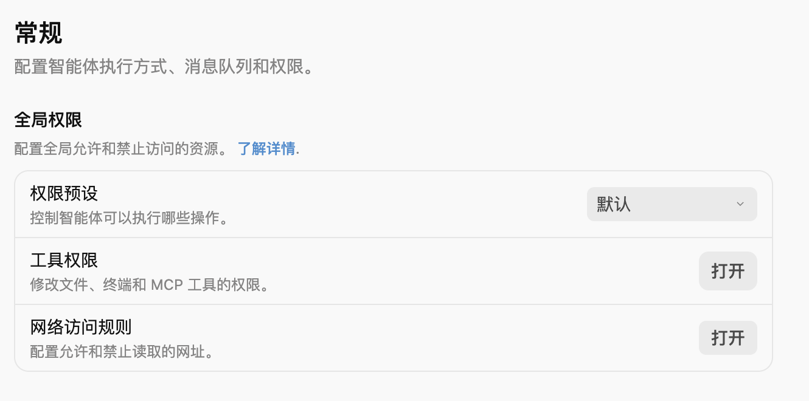
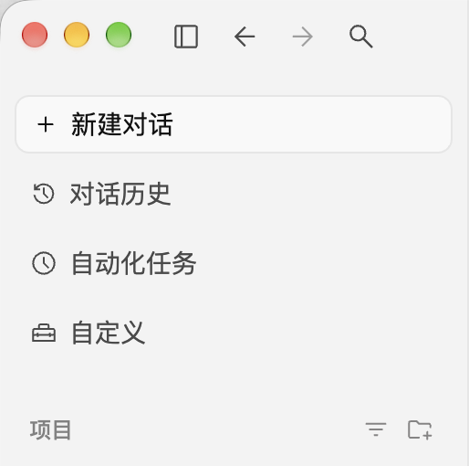
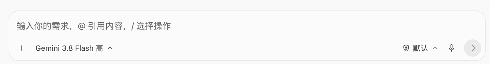

# Antigravity 中文界面 · macOS

给 Antigravity 桌面版做了一个中文适配，主要翻译菜单、模型选择、对话控件和设置页面。目前先做 Mac 版，后续边用边补。

[下载](https://github.com/BAOXIAOPAI/antigravity-zh-cn-macos/releases/latest) · [反馈问题](https://github.com/BAOXIAOPAI/antigravity-zh-cn-macos/issues) · [更新记录](CHANGELOG.md)

## 界面

设置页（局部）：



<details>
<summary>侧边栏和输入区</summary>





</details>

## 怎么用

需要 **macOS**、**Antigravity 独立桌面版**和 **Node.js 22 或更新版本**。目前测试的是 Antigravity **2.26.0**，其他版本还没验证；旧版 IDE 的语言包不在这个项目的适配范围内。

1. 没装 Node.js 的话，先从 [官网](https://nodejs.org/) 安装。
2. 从 [Releases](https://github.com/BAOXIAOPAI/antigravity-zh-cn-macos/releases/latest) 下载 macOS 压缩包，完整解压。
3. 正常打开 Antigravity，再双击 **启动中文适配.command**。终端提示“已适配”后，回到应用即可。

保留适配器的终端窗口运行。下次打开 Antigravity 时，也需要再运行一次启动器。整个文件夹都要保留，不要只拿走两个 `.command` 文件。

如果提示没有执行权限，在解压后的文件夹中运行：

```sh
chmod +x 启动中文适配.command 恢复英文.command
```

也可以从源码启动，无需 `npm install`：

```sh
git clone https://github.com/BAOXIAOPAI/antigravity-zh-cn-macos.git
cd antigravity-zh-cn-macos
node adapter.mjs --restart
```

## 恢复英文

双击 **恢复英文.command**，或在适配器终端按 **Control+C**。

如果直接关掉终端，当前页面可能还会留着中文。先停止适配器，再退出并重新打开 Antigravity，就能清除。要卸载的话，停止适配器后删除文件夹即可。

## 还有哪些没做

- macOS 顶部菜单、系统文件选择器、外部网页和插件自己的界面还没覆盖。
- 部分提示可能仍是英文。模型品牌名、聊天正文、代码和已识别的用户名称会保留原文。
- 目前只有 macOS 版，Windows 后续看使用反馈再考虑。

发现漏译可以提 [Issue](https://github.com/BAOXIAOPAI/antigravity-zh-cn-macos/issues)，写下英文原文和出现的位置。运行问题请带上 Antigravity、macOS 和 Node.js 版本。截图前记得遮住邮箱、对话和文件路径等私人内容。

<details>
<summary>运行方式与开发</summary>

适配器不修改 Antigravity 的应用文件，而是读取它已有的本机调试端口，通过本地 JavaScript 替换界面文字。连接前会检查窗口标题和原生接口。应用更新后，这种方式可能需要跟着调整。

译文放在 `zh-CN.json`。词典和翻译代码保存后会自动重载，重复运行启动器也会平滑替换旧适配器。

```sh
npm test                         # 自动测试
node tests/serve-fixture.mjs     # 本地翻译行为测试页
npm run package                 # 打包 macOS 发布文件
```

测试页面只用于检查翻译逻辑，不代表真实应用界面。

</details>

## 许可

[MIT](LICENSE)。这是个人维护的非官方项目，与 Google 无隶属关系。
