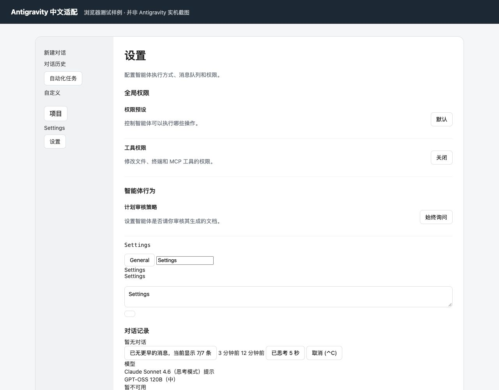

# Antigravity 中文适配 · macOS

给 Google Antigravity 独立桌面版加一层可恢复的简体中文界面。**目前仅支持 macOS。**

这个小项目从自己使用时的需求开始，先把常用界面翻译顺手，再根据反馈逐步补齐。当前包含 **456 条译文**，支持部分动态提示，并能随页面更新自动应用。

[下载 macOS 版本](https://github.com/BAOXIAOPAI/antigravity-zh-cn-macos/releases/latest) · [反馈漏译 / 问题](https://github.com/BAOXIAOPAI/antigravity-zh-cn-macos/issues) · [更新记录](CHANGELOG.md)

> 非官方社区项目，与 Google 无隶属关系。需要自行安装 Antigravity；项目不包含、也不修改原应用文件。

## 使用前确认

| 项目 | 当前情况 |
| --- | --- |
| 操作系统 | macOS，启动器使用系统自带的 zsh |
| Antigravity | 已在独立桌面版 **2.26.0** 上实机验证；其他版本待反馈 |
| Node.js | **22 或更新版本**，不需要安装 npm 依赖 |
| Apple Silicon / Intel | 适配代码不区分架构；尚未分别完成两类设备的实机验证 |
| Windows / Linux | 暂不支持 |

这是独立桌面版的显示适配，不是旧版 Antigravity IDE / VS Code 的语言包。它依赖 Antigravity 2.26.0 默认提供的本机调试接口；应用更新可能影响兼容性。

## 三步开始

1. 安装并正常打开 Antigravity。如果尚无 Node.js，请先从 [Node.js 官网](https://nodejs.org/) 安装 22 或更新版本。
2. 从 [Releases](https://github.com/BAOXIAOPAI/antigravity-zh-cn-macos/releases/latest) 下载 `Antigravity-zh-CN-macOS-v0.2.1.zip`，完整解压到一个有写入权限的本地文件夹。
3. 在 Finder 中双击 **启动中文适配.command**。看到“已适配 … 个窗口”后，回到 Antigravity；保留这个终端窗口运行。

以后打开 Antigravity 时，再运行启动器即可。重复运行启动器会先请求旧适配器退出，再启动新版。

也可以在终端运行：

```sh
git clone https://github.com/BAOXIAOPAI/antigravity-zh-cn-macos.git
cd antigravity-zh-cn-macos
node adapter.mjs --restart
```

如果 Finder 提示没有执行权限，可以在解压后的项目文件夹中运行：

```sh
chmod +x 启动中文适配.command 恢复英文.command
```

## 能翻译哪些地方

- 主界面：侧边栏、输入提示、项目入口、搜索、历史页提示和空状态。
- 模型菜单：思考强度、思考模式、可用状态、提示和用量入口。模型品牌名保留原文。
- 对话页：思考状态与耗时、消息数量、时间提示、复制、撤销、反馈和部分更多操作。
- 设置：权限、外观、通知、模型用量、快捷键等主要文案。
- 已收录的弹窗、工具提示及菜单选项。词典或翻译代码保存后自动重载。

翻译层会跳过已识别的聊天正文、用户名称、代码、编辑器和输入内容；只更改界面文字节点和显示标签。未知文案保留原文，仍可能有漏译，欢迎提交 Issue。

**暂未覆盖：** macOS 顶部原生菜单、系统文件选择器、外部网页、插件自己的界面，以及智能体回答的语言。

下图来自翻译行为测试页，**是测试样例，不是 Antigravity 实机截图**：



## 恢复英文与移除

双击 **恢复英文.command**，或在适配器终端中按 **Control+C**。这会停止观察界面变化，并尝试还原当前已连接窗口的文字。

```sh
node adapter.mjs --restore
```

如果直接关闭终端导致适配器异常退出，当前页面的翻译可能暂时保留。先停止适配器，再退出并重新打开 Antigravity，可清除临时翻译。移除项目时停止适配器、删除文件夹即可；没有安装后台服务或登录启动项。

## 本机调试接口的使用

适配器读取 `~/Library/Application Support/Antigravity/DevToolsActivePort`，只连接该文件所指向的 `127.0.0.1` 调试端口，再检查窗口标题及原生预加载接口后添加翻译层。

它通过调试接口在应用页面执行本地 JavaScript，因此请像对待其他本地脚本一样，只运行你信任的项目副本。项目自身没有外网请求，不上传聊天或文件，不更改账号、权限预设、系统设置，也不会开启新的调试端口或重签名应用。

## 问题反馈

反馈漏译时，提供以下信息会更容易定位：

- Antigravity 版本、macOS 版本、Node.js 版本。
- 出现英文的页面路径或操作步骤，以及原文。
- 截图可选，请先遮住对话内容、邮箱、令牌、文件路径等私人信息。

暂时只维护 macOS 版。如果使用反馈较多，会考虑 Windows 适配；当前没有 Windows 版本或发布时间承诺。

## 开发与验证

```sh
npm test
node tests/serve-fixture.mjs
```

第二条命令输出仅监听本机的测试页地址。浏览器测试检查动态翻译、模型菜单、用户内容保留、按钮事件、恢复和词典热更新。

已有验证记录：12 项 Node.js 测试、44 项浏览器样例检查通过；在 macOS 上确认了 Antigravity 2.26.0 主界面、模型菜单和对话页的主要译文。自动化测试不能代表所有界面及其他设备均已覆盖。

打包 macOS 发布文件：

```sh
npm run package
```

欢迎通过 Issue 或 PR 补充译文。修改 `zh-CN.json` 时请保持 JSON 有效，尽量提交界面中完整、精确的原文，不翻译模型品牌或用户内容。

## 许可证

[MIT](LICENSE)。Antigravity、Google 及相关商标属于各自所有者。
